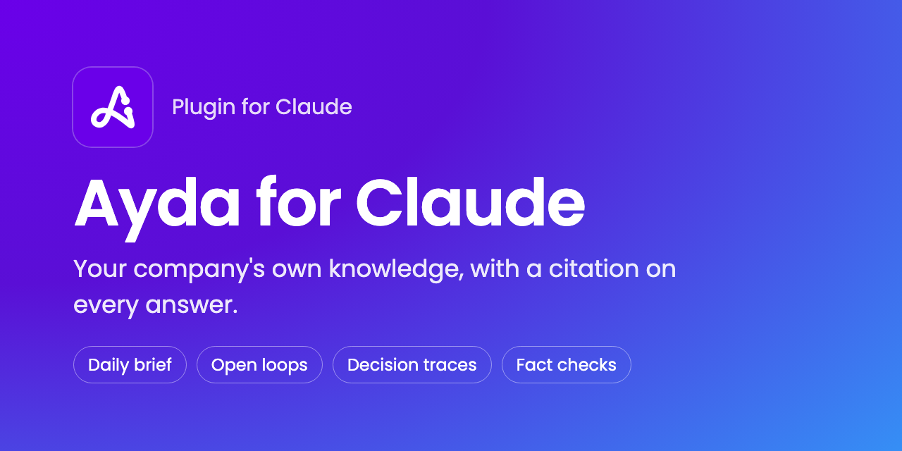
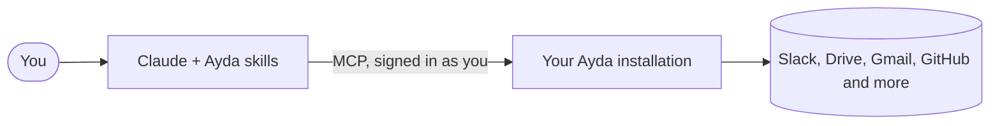

<div align="center">
  <h1>Ayda for Claude</h1>

  <p><strong>Connect Claude and MCP agents to your company's Ayda for cited answers, daily briefs, and open loops.</strong></p>

  <p>
    <a href="LICENSE"></a>
    <a href="CHANGELOG.md#140--2026-11-12"></a>
    <a href="#skills"></a>
  </p>

  <p>
    <a href="#skills">Skills</a> ·
    <a href="#try-it">Try it</a> ·
    <a href="#how-it-works">How it works</a> ·
    <a href="#install">Install</a> ·
    <a href="#data-and-privacy">Privacy</a> ·
    <a href="#evals">Evals</a>
  </p>
</div>

[Ayda](https://aydahq.com) is company memory that your company owns and runs. It
reads the sources your company connects—such as Slack, Google Drive, Gmail, and
GitHub—and answers with a citation for every statement.

This plugin adds seven skills that make Claude use your company's Ayda
installation well: fewer tool calls, a citation on every statement, and the
right date for every fact.

## Skills

### Daily workflows

| Skill | What it does |
| --- | --- |
| `ayda-daily-brief` | Summarises what changed, what you owe, what others owe you, and what looks done. |
| `ayda-loop-sweep` | Walks through your open loops in small batches and records your verdict on each. |
| `ayda-remember` | Saves approved decisions and commitments from a conversation as your Ayda memories. |

### Cited research and checks

| Skill | What it does |
| --- | --- |
| `ayda-decision-trace` | Traces how and why a decision was made and how it changed, with citations. |
| `ayda-fact-check` | Checks a plan, document, or change against recorded company facts. |
| `ayda-onboarding` | Writes a cited brief on a role, team, or project with a reading list. |
| `ayda-guide` | Shared rules for the other skills: call budget, dates, source conflicts, self-checks, and citations. |

Claude selects a skill when your prompt matches it. In Claude Code you can also
invoke one directly (for example `/ayda:ayda-daily-brief`). Name Ayda explicitly
when saving a memory ("save this to Ayda"), since a plain "remember this" writes
to Claude's own memory.

## Try it

- "Catch me up on what I missed yesterday."
- "Which of my open loops look done? Let's clear them."
- "Why did we change payment providers, and when did that happen?"
- "Check this proposal against what we agreed with the client."
- "Save to Ayda that we chose the Q4 pricing on the 12 October call."

## How it works



- **Company-owned:** Claude connects only to the Ayda host you configure.
- **Per-person access:** You sign in with your company account; Ayda returns
  only records you are permitted to read.
- **Verifiable:** Every statement cites its source record so you can open and
  check it.

## Install

You need a company Ayda installation with **Agent access** enabled by an admin
and its host name (for example `ayda.example.com`).

### Claude Code

```text
/plugin marketplace add Ayda-Knowledge/ayda-plugin
/plugin install ayda@ayda
```

Connect your installation using your Ayda host name:

```bash
claude mcp add --transport http --scope user ayda https://<your-ayda-host>/mcp
```

Claude opens a sign-in page on the first call to Ayda.

### Claude apps (`claude.ai`, Desktop, and Cowork)

1. Open **Customize > Plugins**, find **Ayda** in the directory, and install it.
2. Connect your installation:
   - If your organisation already provides an Ayda connector, the skills use it.
   - Otherwise, open **Customize > Connectors**, add a custom connector named
     `Ayda` with URL `https://<your-ayda-host>/mcp`, and sign in. On Team or
     Enterprise plans, an Owner can add it for the organisation.

### Other agents

The skills are standard `SKILL.md` folders. Copy the folders under
[`plugin/skills/`](plugin/skills/) into your agent's skills directory, then
connect your Ayda MCP server using Ayda's **Connect Your Agent** page.

## Data and privacy

Claude sends requests only to the Ayda installation host you configure—never to
Ubundi or another service.

Skills write to Ayda only in two places, and only after your explicit approval:

- `ayda-loop-sweep` records your verdict (`open`, `done`, or `dismissed`) on one
  of your open loops.
- `ayda-remember` stores an approved sentence as your personal memory record
  (extracted decisions stay pending until you confirm them in Ayda).

No skill writes to Slack, Google Drive, Gmail, GitHub, or any other source.

## Evals

The [`evals/`](evals/) suite verifies core behaviour: reading your day in your
time zone, writing nothing before your verdict, ignoring prompt injections in
records, and showing conflicting sources side by side.

`scripts/eval-compare.sh` runs each case against a mocked Ayda with and without
the skills so the delta measures what the skills add. Latest scores live in
[evals/RESULTS.md](evals/RESULTS.md).

## Repository layout

| Path | Holds |
| --- | --- |
| [`plugin/`](plugin/) | Installable plugin manifest, icon, and skills read by Claude |
| [`mod/`](mod/) | Optional Claude Code mod for open loops and source cards (not installed; see [AGENTS.md](AGENTS.md#the-claude-code-mod)) |
| [`evals/`](evals/) | Behavioural eval suite and recorded results |
| `scripts/`, `.github/` | Validation scripts, CI, and development tooling (not installed) |

## Contributing

Read [CONTRIBUTING.md](CONTRIBUTING.md) before proposing a skill or fix. Report
security issues through [SECURITY.md](SECURITY.md).

## Licence

[MIT](LICENSE) © 2026 Ubundi
